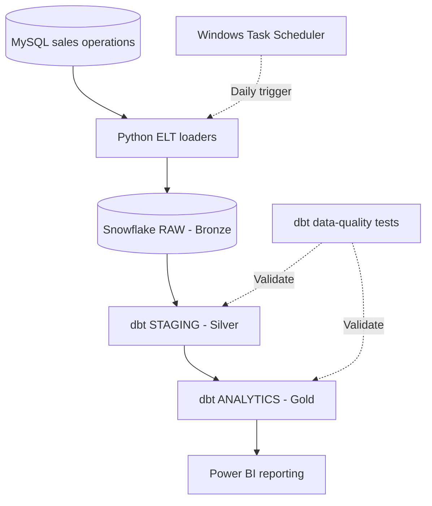
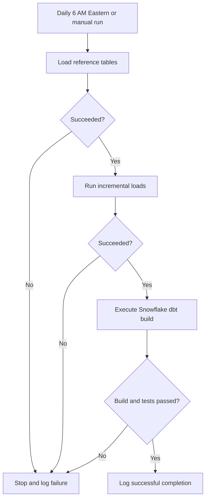
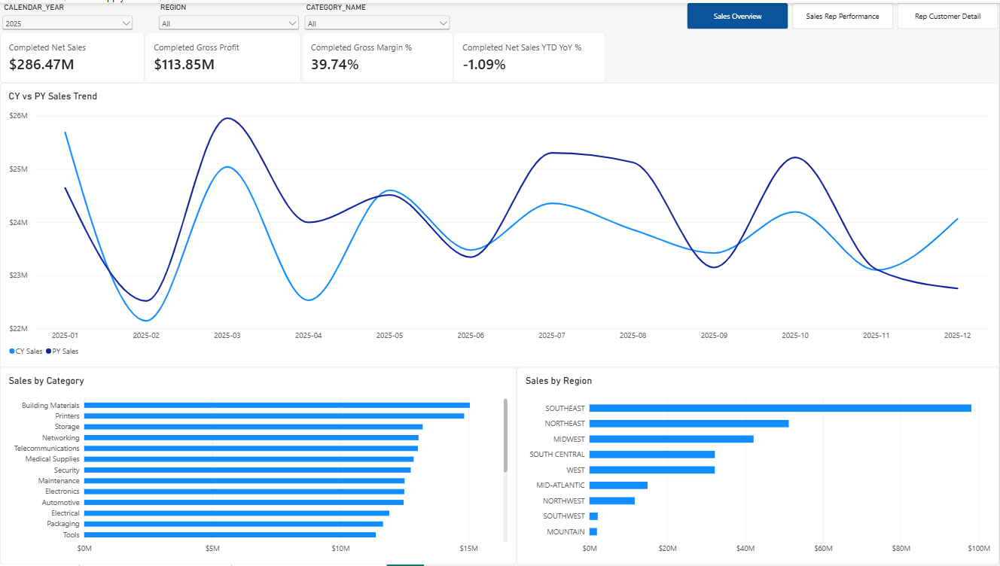
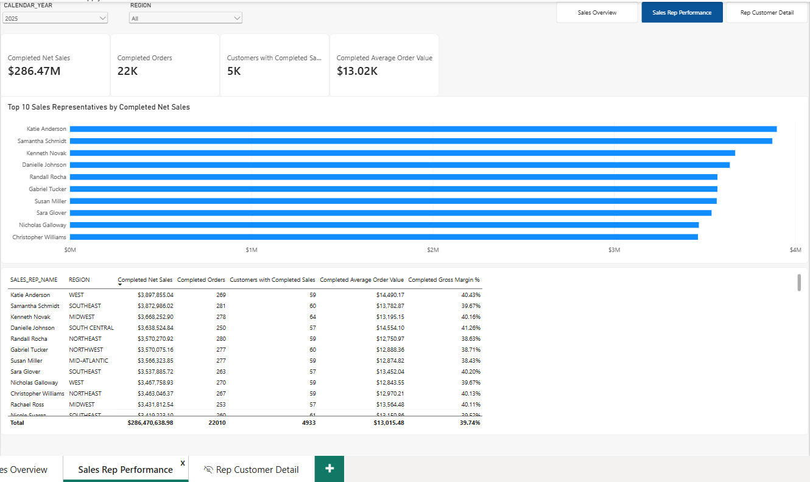

# Enterprise Sales Analytics Pipeline

An end-to-end, automated ELT and business intelligence project built with **MySQL, Python, Snowflake, dbt, and Power BI**.

The project simulates a sales operations environment, moves synthetic transactional data into a cloud warehouse, transforms it into analytics-ready models, validates data quality, and makes the results available for self-service reporting. It demonstrates the engineering work required to deliver trustworthy analytics—not just the final dashboard.

> **Portfolio project:** All source data is synthetic. This is a locally orchestrated demonstration, not a production customer-data system.

## Architecture



| Layer | Technology | Responsibility |
| --- | --- | --- |
| Source | MySQL | Synthetic customers, products, orders, order items, sales reps, territories, and categories |
| Ingestion | Python, pandas, SQLAlchemy | Reference-table loads, incremental extraction, and upserts |
| Bronze | Snowflake `RAW` | Source-aligned warehouse tables |
| Silver | dbt `STAGING` | Consistent, cleaned, reusable source models |
| Gold | dbt `ANALYTICS` | Dimensions, fact table, and monthly sales mart |
| Reporting | Power BI | Business-facing sales analytics |
| Operations | Windows Task Scheduler, Python, Snowflake | Daily execution, load watermarks, dbt builds, and logs |

## Business scenario and data

The synthetic MySQL sales system includes approximately:

- **100,000 orders** and **299,449 order items**
- **5,000 customers** and **1,000 products**
- **100 sales representatives**, **20 territories**, and **25 product categories**

The resulting warehouse supports analysis across customers, products, sales representatives, dates, and monthly sales performance.

## How the pipeline works

### 1. Incremental ingestion into Snowflake

The Python loaders separate source tables into two groups:

- **Incremental entities:** `products`, `customers`, `orders`, and `order_items` use MySQL `updated_at` timestamps and watermarks maintained in Snowflake `OPS.LOAD_WATERMARKS`.
- **Reference entities:** `territories`, `sales_reps`, and `product_categories` are read in full and upserted into Snowflake each run.

Incremental loading uses a **five-minute lookback window** to reread recent source rows, temporary Snowflake staging tables, and `MERGE` operations to insert new records or update changed records. Reprocessing an unchanged row does not automatically create another destination update.

The watermark advances to the MySQL source cutoff timestamp after successful processing. This avoids resetting the extraction window on every run while supporting repeatable, idempotent upserts for the tested scenarios.

### 2. Transformations with dbt

The dbt project is deployed as a Snowflake-managed dbt project object:

`ENTERPRISE_SALES_DW.OPS.ENTERPRISE_SALES_DBT`

Its business models include seven staging models and six analytics models:

| Staging / Silver | Analytics / Gold |
| --- | --- |
| `stg_customers` | `dim_customer` |
| `stg_products` | `dim_product` |
| `stg_product_categories` | `dim_sales_rep` |
| `stg_sales_reps` | `dim_date` |
| `stg_territories` | `fact_sales` |
| `stg_orders` | `mart_monthly_sales` |
| `stg_order_items` | |

The Gold layer supports a dimensional reporting model centered on sales transactions, with reusable dimensions and a monthly aggregate mart.

### 3. Data-quality checks

The dbt project includes **50 data tests**, including:

- Not-null and uniqueness checks for key columns
- Relationship checks between related entities
- Validity checks for order-item values
- Reconciliation of fact sales and monthly mart results
- Uniqueness checks at the monthly mart's intended grain

On November 16, 2026, the recorded dbt build completed with **65 passes, 0 warnings, 0 errors, and 0 skips** (14 table models, 1 view model, and 50 data tests).

### 4. Orchestration and scheduling

[`python/12_run_raw_pipeline.py`](python/12_run_raw_pipeline.py) coordinates the full process. It stops if a step fails and writes timestamped execution logs to the local, Git-ignored `logs/` directory.



The Windows Task Scheduler job is configured for **6:00 AM Eastern daily**. The task was successfully invoked manually; an unattended scheduled run was not yet verified at the time of the validation report. The computer must be running or able to wake for the local schedule to execute.

## End-to-end validation

A controlled update to a synthetic MySQL customer was used to verify that the pipeline propagated a changed value all the way to Snowflake `RAW.CUSTOMERS`, `STAGING.STG_CUSTOMERS`, and `ANALYTICS.DIM_CUSTOMER`.

| Validation | Observed result |
| --- | --- |
| Changed MySQL customer | `updated_at` advanced automatically |
| First incremental run | 1 customer staged; 0 inserted; **1 updated** |
| RAW → STAGING → ANALYTICS | Updated customer name verified in all three layers |
| dbt build | **65 passed**, 0 warnings/errors/skips |
| Second run without source changes | 1 row reread within overlap; **0 inserted, 0 updated** |
| Scheduler | Manual scheduled-task invocation succeeded |

For reproducible queries, test evidence, and the limitations of the verification, see:

- [Validation report](docs/VALIDATION.md)
- [Read-only end-to-end validation SQL](sql/08_validate_end_to_end_pipeline.sql)

## Repository structure

```text
enterprise_sales_pipeline/
├── dbt/enterprise_sales_dbt/   # dbt project, SQL models, YAML, macros, tests
├── docs/                       # Validation and project documentation
├── pbi/                        # Power BI report and dashboard screenshots
├── python/                     # Data generation, loaders, orchestration
├── sql/                        # MySQL and Snowflake setup/validation SQL
│   └── snowflake/
├── .gitignore                   # Excludes local secrets and build artifacts
├── requirements.txt            # Python dependencies
└── README.md
```

The following local or generated files are intentionally not included in source control: `.env`, private keys, runtime `logs/`, dbt `target/`, `dbt_packages/`, and downloaded build artifacts.

## Running the project

### Prerequisites

- Python and the packages in [`requirements.txt`](requirements.txt)
- Access to a MySQL instance containing the synthetic sales operations schema
- A Snowflake account with access to the database, warehouse, and deployed dbt project
- Locally configured authentication and environment variables (do not commit credentials)
- Power BI Desktop to open the included `.pbix` report

Install the Python dependencies in an appropriate environment:

```powershell
python -m pip install -r requirements.txt
```

For an environment that has already been set up and populated, run the orchestrator from the repository root:

```powershell
python python/12_run_raw_pipeline.py
```

The orchestrator runs these scripts in order:

1. [`11_load_reference_tables.py`](python/11_load_reference_tables.py)
2. [`10_incremental_load.py`](python/10_incremental_load.py)
3. [`13_run_dbt.py`](python/13_run_dbt.py), which executes the deployed dbt project with `build --target dev`

The SQL setup scripts under `sql/` and `sql/snowflake/` document the initial database and schema creation. **Review them before running against an existing environment:** the normal daily command assumes the initial MySQL and Snowflake objects already exist. Re-running data generators or setup scripts may alter an existing dataset.

The dbt source under `dbt/enterprise_sales_dbt/` is a local copy of the deployed project. **Editing it in VS Code does not automatically update Snowflake**; changes must be deployed separately before the scheduled orchestrator will execute them.

## Power BI

The Power BI report, [`Enterprise_Sales_Analytics.pbix`](pbi/Enterprise_Sales_Analytics.pbix), consumes analytics-ready data from Snowflake. It provides interactive filters and views for both business-level performance and sales-representative analysis. The screenshots below show **synthetic 2025 data**.

### Sales Overview



*Sales Overview: net sales, gross profit, margin, year-over-year growth, current-year versus prior-year monthly trends, and performance by product category and region. Report filters include year, region, and category.*

### Sales Representative Performance



*Sales Rep Performance: top-performing representatives and a detailed table of net sales, completed orders, customers with completed sales, average order value, and gross margin. The report also includes navigation to a representative/customer detail page.*

Automatic refresh of a Power BI Desktop import after pipeline execution has not yet been demonstrated.

## Scope and next improvements

This project demonstrates a working portfolio-scale pipeline. Current limitations include:

- **Upserts, not full CDC:** source deletions are not propagated automatically.
- **Late-arriving changes:** records older than the five-minute lookback or with backdated timestamps are not guaranteed to be captured.
- **No Type 2 history:** historical changes to reference attributes are not retained as slowly changing dimensions.
- **Local scheduling:** Windows Task Scheduler is not a cloud-hosted orchestrator; automatic alerting and recovery are future improvements.
- **Validation scope:** customer updates and no-change reruns were verified; deliberate failure injection, new-order end-to-end propagation, unattended scheduling, and Power BI refresh still require separate tests.

Potential next steps include CI/CD for dbt deployments, automated failure notifications, source-deletion handling, controlled backfills, and published report screenshots.

---

Built as a hands-on demonstration of **analytics engineering, incremental ELT, dimensional modeling, data quality, orchestration, and business intelligence**.
